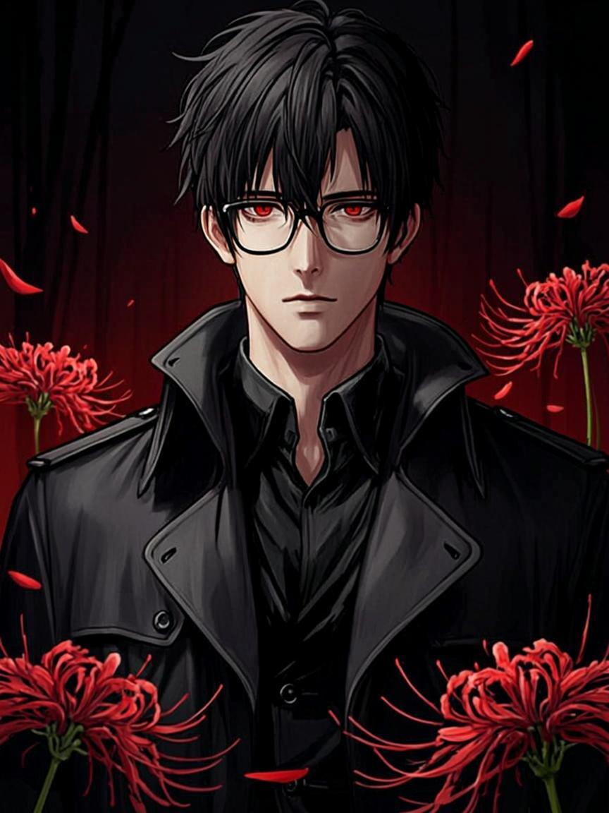
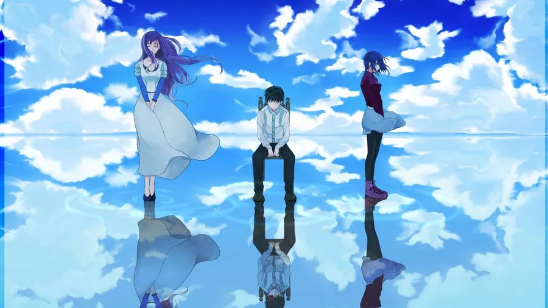

<!-- ══════════════════════════ CABEÇALHO ══════════════════════════ -->

  

<!-- Banner: higanbana (flor de aranha vermelha) desabrochando — símbolo icônico de Tokyo Ghoul -->

  

 

  
  
  

 

<!-- ══════════════════════════ NAVEGAÇÃO ══════════════════════════ -->

  
  
  
  
  

---

## 🧬 SOBRE MIM

<table>
  <tr>
    <td width="300" valign="middle">
      <!-- Retrato original em P&B no estilo do mangá Tokyo Ghoul (Sui Ishida) -->
      
    </td>
    <td valign="middle">

👋 Salve! Sou o **João Vitor**, desenvolvedor **full-stack** e criador nato. Transformo ideias em **interfaces imersivas** e sistemas que funcionam de verdade — do primeiro rascunho ao deploy.

- 🎯 **Foco atual:** interfaces cinematográficas e sistemas web completos
- 🌱 **Aprendendo:** TypeScript, Next.js e Docker
- 🧪 **Qualidade:** práticas de TDD e testes automatizados nas aulas de Garantia & Qualidade de Software
- 🤖 **Curiosidade:** fascinado por IA — meu projeto mais recente faz IAs debaterem entre si
- 🎮 **Fora do código:** games, música e lore de animes
- 🩸 **1000 - 7 = ?** — *a conta que você nunca vai esquecer*

> *"A excelência está nos detalhes que ninguém percebe."*

</td>
</tr>
</table>

---

## ⚡ HABILIDADES

  <h3>🎨 Front-end</h3>
  

    
    
    
    
    
    
  

  <h3>⚙️ Back-end & Banco de Dados</h3>
  

    
    
    
    
    
  

  <h3>🛠️ Ferramentas</h3>
  

    
    
    
    
    
  

  <h3>🚀 Em Evolução</h3>
  

    
    
    
  

---

## 📁 PROJETOS EM DESTAQUE

<table>
  <tr>
    <td width="50%" valign="top">
      <h3 align="center">🤖 DebateIA</h3>
      
Arena de debates entre IAs: monte um painel com ChatGPT, Claude, Gemini, Grok e mais, escolha a <b>IA Chefe</b> e receba a resposta final consolidada. 100% no navegador — sem API e sem cadastro.

      

        
        
      

      

        
        
      

    </td>
    <td width="50%" valign="top">
      <h3 align="center">💰 Fluxo — Controle Financeiro 2.0</h3>
      
Sistema web de finanças pessoais: registro de gastos, metas e visão geral do orçamento num dashboard limpo e direto.

      

        
        
        
      

      

        
        
      

    </td>
  </tr>
  <tr>
    <td width="50%" valign="top">
      <h3 align="center">🩸 Site Temático Kaneki</h3>
      
Experiência imersiva no universo de Tokyo Ghoul: fichas de personagens, trilha sonora e visual cinematográfico preto & vermelho.

      

        
        
        
      

      

        
        
      

    </td>
    <td width="50%" valign="top">
      <h3 align="center">💉 Studio Tattoo Alisson</h3>
      
Site portfólio para estúdio de tatuagem, com galeria de trabalhos e apresentação profissional do artista.

      

        
        
      

      

        
        
      

    </td>
  </tr>
  <tr>
    <td width="50%" valign="top">
      <h3 align="center">📦 Supplies Locação</h3>
      
Site comercial para locação de impressoras, com catálogo de equipamentos e identidade visual própria.

      

        
        
      

      

        
        
      

    </td>
    <td width="50%" valign="top">
      <h3 align="center">🏠 Portfólio Principal</h3>
      
Meu site pessoal completo: sobre mim, habilidades, projetos e formas de contato em uma experiência autoral.

      

        
        
        
      

      

        
        
      

    </td>
  </tr>
</table>

---

## 📊 ESTATÍSTICAS

  
  

 

  
  

 

  

### 🐍 A Snake das Contribuições

  <picture>
    <source media="(prefers-color-scheme: dark)" srcset="https://raw.githubusercontent.com/Lebot007/Lebot007/output/github-contribution-grid-snake-dark.svg" />
    <source media="(prefers-color-scheme: light)" srcset="https://raw.githubusercontent.com/Lebot007/Lebot007/output/github-contribution-grid-snake.svg" />
    
  </picture>

---

## 📬 CONTATO

  💡 Aberto a novas conexões, colaborações e projetos — chama na conversa!

  
  
  
  
  
  

---

<!-- ══════════════════════════ RODAPÉ ══════════════════════════ -->

<!-- Cena final do ending de Tokyo Ghoul √A: Kaneki, Rize e Touka -->

  

  <i>"A kagune de um dev é o código: cresce, se adapta e fica mais forte a cada batalha."</i>

 

  <h3>喰 • JOÃO VITOR © 2026 • 喰</h3>

 

  <a href="#top">⬆ Voltar ao topo</a>

